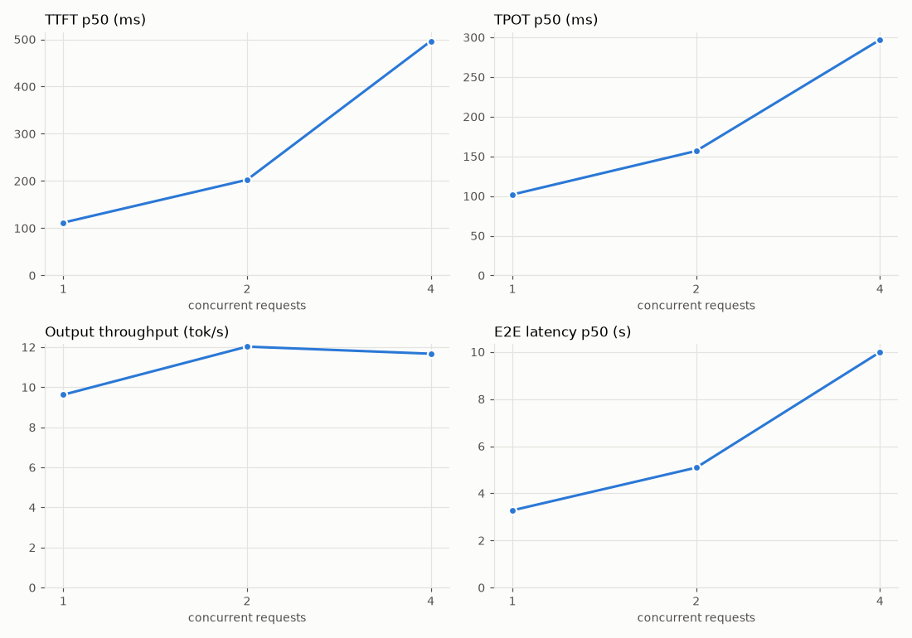
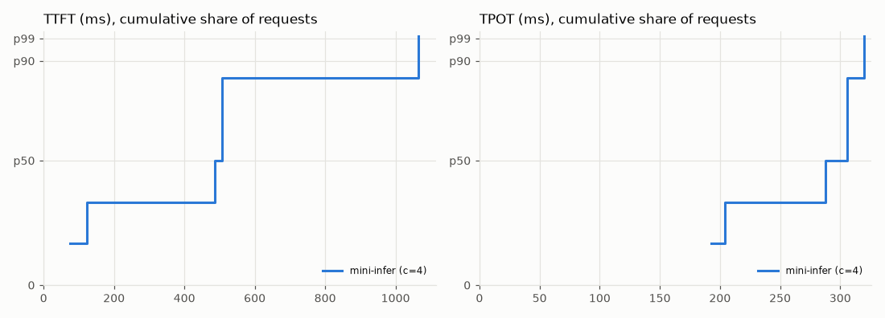

# servebench report

## mini-infer

| | |
|---|---|
| model | qwen2.5-0.5b |
| url | http://127.0.0.1:8000/v1 |
| endpoint | chat |
| prompts | synthetic, input ~32 tok, output 32 tok |
| ignore_eos | True |
| seed | 1019022513 |
| server | OpenAI-compatible, qwen2.5-0.5b |
| machine | AMD Ryzen 5 6600H with Radeon Graphics, 15.3 GB RAM, NVIDIA GeForce RTX 3050 6GB Laptop GPU, 6.0 GB |
| client | servebench 1.0.1, Python 3.12.10, Windows 11 |
| when | 2026-10-19T15:16:11+00:00 |
| notes | - |

| load | ok/fail | req/s | out tok/s | TTFT p50 | TTFT p99 | TPOT p50 | TPOT p99 | ITL p50 | E2E p50 (s) | goodput | tok/chunk | in SLO |
|---|---|---|---|---|---|---|---|---|---|---|---|---|
| c=1 | 6/0 | 0.30 | 9.6 | 112 | 171 | 102 | 111 | 100 | 3.28 | 0.00 | 1.00 | 0% |
| c=2 | 6/0 | 0.38 | 12.0 | 203 | 380 | 157 | 208 | 136 | 5.09 | 0.00 | 1.00 | 0% |
| c=4 | 6/0 | 0.36 | 11.7 | 496 | 1037 | 297 | 319 | 0.3 | 9.99 | 0.00 | 1.00 | 0% |

Latencies in ms unless noted. Goodput = req/s meeting TTFT < 500 ms and TPOT < 50 ms.
> Small sample size at c=1, c=2, c=4 (<100 requests): p99 metrics approximate the sample maximum. Run >=100 requests for statistically confident p99s.
